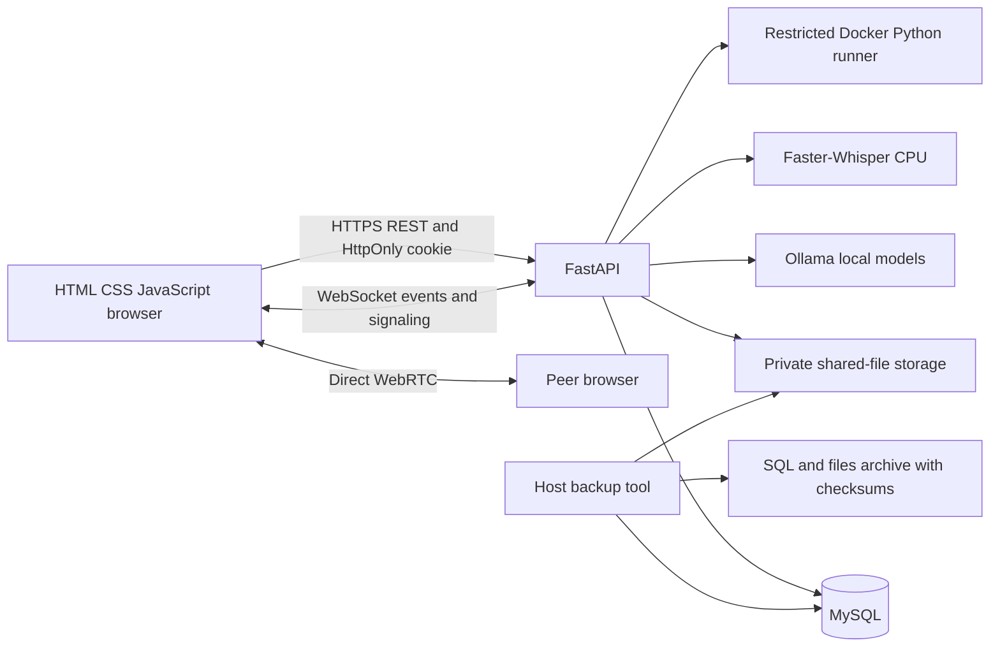

# InterviewAce AI — project guide

## 1. Purpose and technology boundaries

InterviewAce supports focused peer interviews and solo AI practice. A room has one interviewer and one candidate and lasts at most 900 seconds. Users can hold different roles in different rooms. The user's explicit technology constraints override the attached PDFs' React/PostgreSQL/SQLite/C++ suggestions.

The backend and processing tools are Python; the API is FastAPI; persistent application data is MySQL using SQLAlchemy/PyMySQL. The browser is HTML, CSS and vanilla JavaScript. Local AI uses Ollama with Qwen2.5 1.5B for chat and Nomic embeddings for retrieval, LangChain for model calls and LangGraph for solo question/evaluation transitions. Optional speech uses Faster-Whisper. All services can run locally without paid API keys. Hardware, electricity and any public hosting are separate resources, not free-service guarantees.

## 2. Architecture

MySQL owns account/session records, room roles, deadlines, events, documents and results. WebSocket connections and throttling counters live in the single API process. Uploaded files remain under `data/resumes`, never public static storage. Peer RAG extracts PDF pages, DOCX text, PPTX slides and user-supplied image captions with local Python libraries; embeddings are computed per request and kept separate from the optional solo Chroma knowledge index. Image files are shared in their original format, with a caption used as searchable text; OCR is not included.

## 3. Registration and profile data

Registration requires `first_name`, `last_name`, `contact_number`, `email`, `password` and `confirm_password`. The former full-name registration parameter is rejected rather than silently ignored.

| Field | Server behavior |
| --- | --- |
| First and last names | Each 1–50 input characters; Unicode letters, spaces, apostrophes, hyphens and periods; normalized to NFC; whitespace collapsed; at least one letter. Combined display name is at most 100 characters. |
| Contact | Country code required; spaces, parentheses and hyphens removed; stored as `+` followed by 8–15 ASCII digits, first digit nonzero. This checks format only, not number ownership or reachability. |
| Email | Validated email; stored lowercase; unique index prevents duplicate accounts, including concurrent duplicates. |
| Password | 12–128 characters; uppercase, lowercase, a number and a non-whitespace symbol; no leading/trailing whitespace or control characters. Common strings such as password/qwerty/letmein/application name are rejected. Registration rejects inclusion of an email local part of at least four characters. |
| Confirmation | Must exactly match. Confirmation is not stored. Passwords are not trimmed. |

The browser supplies autocomplete attributes, an international-number example, a five-rule password meter, password show/hide, a live mismatch message and inline server errors. The meter checks the five composition requirements; the server additionally checks common terms and email overlap. It is not a breach-database lookup or a guarantee of password entropy.

The account owner can read/update their name and contact through `/api/me`. Contact numbers never appear in room snapshots, peer reports or monitoring. No SMS/email verification or external delivery service is introduced. Database contact fields are access-controlled but not application-level encrypted; disk encryption and backup protection are operator responsibilities.

Existing accounts are migrated additively. Their old display names are split into first name and remaining last name. Unknown contacts and absent last names stay empty; users supply them when updating profiles. Existing password hashes are preserved so old users can log in; new registrations, changes and resets must meet the new password policy.

## 4. Authentication and session lifecycle

Passwords and recovery codes use Argon2. Browser registration/login sets `interviewace_session` with HttpOnly, SameSite=Strict and Path=/. Set `COOKIE_SECURE=true` for HTTPS so the Secure flag and HSTS header are enabled. The local HTTP demo uses Secure=false.

Browser JavaScript never stores the JWT in localStorage or sessionStorage. The old sessionStorage token key is removed on load. Browser requests send `X-Requested-With: InterviewAce`; browser auth responses omit the token and use the cookie. Direct API clients may omit that browser header and receive a JWT for `Authorization: Bearer ...` use. Keep those API tokens secret.

Each JWT has a random ID, user subject, expiry and account token version. MySQL stores only its SHA-256 digest with creation, last-use and expiry timestamps. Every authenticated operation checks the signature, account existence, account version, session existence, revocation, absolute expiry and idle expiry. Default limits are eight hours absolute and thirty minutes idle. Last-use writes are coalesced to at most once per minute. Server-generated WebSocket timer ticks do not extend idle sessions; user messages do.

Logout deletes the active session, records revocation and clears the cookie. Logout-all deletes all sessions for that account. Password change requires the current password and confirmation, revokes prior sessions, and issues a replacement browser cookie. Password reset requires the private recovery code, invalidates all sessions, increments the account token version and rotates the recovery code. Save each replacement code; no email sender is used. Existing users can generate a code after confirming their password.

Mutating cookie-authenticated requests require the custom request header. Supplied Origins must match the configured public origin or the validated local host. There is no permissive CORS configuration. WebSockets check Origin, cookie/token authentication, room membership and role. Session/access invalidation closes the socket. Test/direct API bearer requests remain supported. The Vercel + PC deployment requests a 45-second, one-use, room-scoped WebSocket ticket over its same-origin API proxy; the backend retains the login token and never sends it to frontend JavaScript.

## 5. Dashboards, CRUD and roles

After login, Home remains visible with a personalized card and clear AI Practice/Peer Rooms choices. Navigation separates Home, AI Practice, Peer Rooms, History and Profile. The solo studio is a visible page, not a collapsed detail block. Profile and history no longer crowd room setup. MySQL session persistence returns users to Home after refresh without re-entering credentials until expiry.

| Operation | Allowed actor |
| --- | --- |
| Create a room | Authenticated user, becoming its interviewer |
| Join a waiting room | A second authenticated user, becoming its candidate |
| Start/end, set questions/problems, generate private RAG drafts | That room's interviewer |
| Edit/synchronize/run/submit Python code | That room's candidate while active |
| Chat and direct media | Either participant while active |
| Upload learning resources in supported formats | Either participant before completion |
| Upload a resume | Candidate only |
| Read shared files or final reports | Room participants only |
| Delete an uploaded file | Its owner only |
| Submit final human feedback | Interviewer after completion |
| Delete waiting/completed room and undo within five seconds | Its interviewer |
| Read/update/delete profile; end own sessions | Account owner |

Access checks are enforced by the backend even when a caller bypasses the UI. Invitation codes use random identifiers; third participants cannot enter an occupied room. Users do not receive global administrator powers by selecting a dashboard.

## 6. Interview room and real-time flow

1. Interviewer creates a room with a topic/target role and 60–900 second duration.
2. Candidate joins using the room code or `/?room=CODE` invitation. Self-joining does not occupy the candidate slot.
3. Interviewer starts after the candidate joins. MySQL records start time and duration.
4. A background task and every relevant request enforce expiry. End time on expiry is exactly start plus duration; Unix timestamps use DOUBLE for MySQL precision.
5. Timer frames arrive each second. Low-time styling starts at one minute. Browser timers do not authorize continued activity.
6. Both users can chat. Interviewer questions and assigned problems are persisted as events. Code edits are debounced and synchronized; refresh restores persisted code/events.
7. End/expiry stops interview activities and enables the report. Human final feedback can be submitted afterwards.

The WebSocket path is `/api/rooms/{id}/ws`. First send `{ "authenticate": true }` with a browser cookie, `{ "token": "API_TOKEN" }` for direct clients, or `{ "ticket": "ONE_USE_ROOM_TICKET" }` after calling `POST /api/rooms/{id}/ws-ticket`. Tickets expire after 45 seconds, are tied to the issuing user and room, and are consumed on the first connection attempt. Server events include `refresh`, `timer`, `code`, `offer`, `answer`, `ice`, `error`, and `deleted`. Client chat/code messages are size-limited and role-checked. Refresh fetches the current authorized snapshot. Private RAG draft events are filtered from candidate snapshots. Deletion hides a room immediately, stores its five-second undo deadline in room events, and permanently removes the room and its files after the deadline; only its interviewer can undo it.

Media signaling is allowed while waiting as well as while active; it never starts the timer. Chat, questions and code mutations remain restricted to active sessions. Room tabs expose Live & chat, Coding editor, PDFs & resume, and Feedback & report. The compact room summary separates title/role, duration, code, actions and a collapsible invitation URL.

WebRTC carries media directly between browsers. Users explicitly enable camera/microphone, then the interviewer initiates connection. Mute/unmute and camera controls affect local tracks. Localhost or HTTPS is required. The initial configuration uses direct peers, without an included TURN service; physical devices, browser permission differences and remote-network routing need manual checks. Media stops when a room closes. Browser tests use synthetic devices, not a user's actual camera/microphone.

Camera and microphone are requested separately so a missing/blocked camera does not disable an available microphone. Both can be previewed before the timer starts. Permission-denied, missing-device and busy-device errors have specific instructions. Offer collision handling, reserved transceivers, queued ICE and a playback button handle negotiation and autoplay restrictions. A peer can receive an offer before enabling their own devices and then add tracks after consent.

## 7. Python coding system

The interviewer selects a bundled sum/reverse problem or creates a custom statement, constraints, starter script and 1–5 input/expected-output cases. The execution contract is a Python script reading standard input and printing standard output. The native textarea follows the requested frontend stack; Monaco, C++ and collaborative editing are excluded.

The editor is reachable through the Coding editor tab and Open coding editor button, including while waiting. The UI explains read-only interviewer access and when candidate controls unlock. Run/Submit require an active session and an assigned problem. Solo AI practice is answer-based; peer coding is a separate mode.

Only the candidate can edit, run or make one final submission. The interviewer sees read-only live code and execution results. Run results do not count as a final score. After final submission the problem cannot be replaced. A changed problem or expired deadline during execution rejects the stale result.

Each test runs in a disposable Docker container with no network, read-only root and source mount, a non-root user, dropped capabilities, no-new-privileges, 128 MB memory, 0.5 CPU, 32 PIDs, CPU/file limits, a bounded writable tmpfs and an execution timeout. Output returned to the API is truncated. The Docker CLI is invoked without a shell. Missing/disabled Docker fails closed: there is no host execution fallback.

This is a local educational sandbox, not a public multi-tenant security certification. The Docker daemon is highly privileged; never expose its socket publicly. The public Linux service template disables code execution until a separately reviewed runner deployment exists.

## 8. Shared-file RAG and resumes

Shared PDFs, DOCX, PPTX, PNG, JPG, GIF and WebP files are limited to 3 MB. PDFs must be valid, selectable-text, unencrypted files with at most 30 pages. PowerPoint supports at most 30 slides; Word text is grouped into searchable sections. Images are shared in their original format and need a user-written caption for RAG; image OCR is not implemented. Solo resumes remain selectable-text PDFs limited to 10 pages. File names are not used as storage paths; random server-generated names prevent path traversal. Downloads use authenticated APIs, not static URLs.

Peer retrieval extracts PDF page, DOCX section and PPTX slide text, or uses an image caption; it forms overlapping chunks, obtains local Nomic embeddings and ranks cosine similarity within the selected document. LangChain sends the top passages to local Qwen for a JSON question and suggested answer. Drafts include source filename, location and excerpt. Source text is labeled untrusted data. The interviewer reviews/edits the question and sends it explicitly; candidates cannot read the private answer bank. AI output is practice material requiring human review.

Resume analysis runs automatically on candidate resume upload. It checks contact, education, projects, experience, skills, readable length and measurable details. Those checks contribute 80%; room-topic keyword relevance contributes 20% when meaningful target terms exist. Findings, matched/missing terms and three suggestions are retained with the PDF. This estimates resume quality, not truth or verified qualifications. New uploads provide comparison history while retained; deleting a document removes its stored analysis and changes reports derived from retained records.

Solo RAG uses the curated `knowledge/` notes and optional local Chroma index populated by `python -m backend.ingest`. Private peer documents are not added to that global collection.

## 9. Communication and consent

The candidate must consent before recording or uploading audio for analysis. Recording is explicit and separate from the live WebRTC call. Supported file extensions are webm, wav, ogg, mp3 and m4a, with a 15 MB upload limit and maximum 15-minute decoded duration. Stop/submit audio before interview expiry. A started transcription may complete afterwards.

Faster-Whisper tiny.en runs on CPU/int8; the model is cached after first load. It produces a transient transcript and segment times. Metrics include word count, words/minute, duration, filler count, pauses of at least one second between segments and organization-marker count. Raw audio is deleted in a finally block; transcripts are not persisted. Only derived metrics are retained.

Communication score is 50% pacing and 50% filler frequency. Pacing scores 100 within 100–180 words/minute and reduces outside that range; fluency reduces with fillers per word. Pauses and organization phrases are descriptive proxies, not validated clarity, honesty, personality or confidence measurements. Human communication feedback is separate.

## 10. Reports, score formula and history

### Solo AI voice and visual presence

AI Practice includes a clearly labeled animated SVG coach, not a live human or photorealistic generated video. Read-aloud uses only voices reported as local by the browser; if no installed voice exists, a clear fallback keeps text practice available. The browser does not silently use a remote speech service. Camera preview is optional and never automatically recorded.

The Interview type selector offers Technical, HR / Behavioral, Mixed and Custom. Custom reveals a required 3–100 character printable focus, such as System design. `kind=custom` and nullable `custom_kind` are saved separately; LangGraph receives that custom focus for question generation and answer evaluation, including after reopening a session. Switching back to a standard type discards a stale custom value. Existing databases receive an idempotent nullable column addition without changing older interviews.

Questions offers the quick presets and Custom, which reveals an integer input from 1 to 50. Client and API enforce the same range; the API rejects fractional counts, booleans and numeric strings. Questions are generated one at a time. The selected limit determines when the session completes.

When the camera is off, its preview shows the first letter of the signed-in first name. It updates after profile changes and reappears after camera toggle-off, device loss or device shutdown. SVG camera and microphone buttons expose their state through `aria-pressed`, their slash mark, accessible labels and tooltips; the power icon stops both devices. No icon requests devices until clicked. Muting the microphone also mutes an active solo recording's cloned track.

After starting a solo interview, users may consent to record an answer (two-minute client limit). `/api/interviews/{id}/transcribe` validates ownership, consent, active status, audio extension and the 15 MB upload limit, then runs local Whisper. It returns a transcript draft plus metrics. The raw upload is deleted in a finally block; the draft is not saved as an answer until the user reviews and submits the text. Leaving the view, switching interviews or submitting cancels/invalidates pending recording results. Physical sound playback still depends on local voices, browser settings and hardware.

Completed peer reports combine final code results (40%), human technical/problem-solving mean (30%), automated speech (20%) and resume quality (10%). Missing components remain null/unavailable. Available weights are renormalized; absent data is never silently scored zero. Human communication ratings are shown separately.

Reports include duration/status, topic, sent questions, final source/test results, human strengths/improvements, available automated findings, next steps and a JSON download. Scores in history use retained completed reports. Scores are study feedback, not hiring assessments. Deleted source records are not secretly retained in a second report snapshot.

Solo evaluation uses correctness 40%, relevance 25%, clarity 20% and examples 15%. LangGraph chooses easy below 50, hard from 80 and medium otherwise, stopping at the configured 1–50 questions.

## 11. Reliability, error handling and UI performance

Security headers include CSP, nosniff, frame denial, referrer restrictions, camera/microphone permissions policy and HSTS on HTTPS configurations. API responses are no-store. Static responses revalidate after a short cache lifetime; versioned stylesheet/script URLs avoid stale asset changes. Gzip handles larger responses. Fonts/icons/charts have no external CDN dependency; JavaScript loads with defer, code edits are debounced, score charts use native HTML meter bars and readable text, and media is opt-in. Bars remain sharp when a hidden history panel is revealed, resized, zoomed or moved to a high-resolution screen.

Validation errors contain only safe locations/messages/types, not raw passwords or request bodies. Database failures return a safe 503 and unexpected failures return a generic 500 with a request ID. Network/timeout errors have readable browser messages. Offline status is visible. Mutating operations are not automatically retried because a lost response might already have committed.

Authentication is throttled per IP/endpoint to 20 requests per ten minutes; processing endpoints share a 30/minute limit per IP. In-memory buckets are bounded at 5,000 entries. These counters reset on process restart and are not distributed. Proxy trust must be configured narrowly. Request bodies advertise a 20 MB maximum; individual uploads and Pydantic fields impose tighter limits, and nginx provides an actual body-size cap for deployed traffic.

The responsive layout supports keyboard focus, a skip link, associated labels, semantic details/dialog controls, screen-reader status regions, touch-sized buttons, mobile form rows and reduced-motion preferences. Title/description/Open Graph/favicon/robots metadata cover public-page SEO. Private account/room data is not intended for indexing. This is not a completed WCAG certification or an SEO ranking promise.

The single shared header provides Home and guest “How it works” links; signed-in members also see AI practice, Peer rooms, History and Profile. The selected page is marked with `aria-current`. The account badge, logout and accessible sun/moon theme button share the same header. At smaller widths its links wrap into a second row inside that header; there is no separate studio navigation bar. The shared footer credits **Created by Zaman & Saloni** and links to Services, Contact us, Terms & Conditions and Privacy Policy. These links open anchored public sections in `/assets/info.html`, available without login. Contact publishes only the explicitly supplied support email, `zamanuddinkhan1@gmail.com`, as a mailto link; no account phone number is published. Sending email requires the visitor's configured email app; there is no simulated contact form. The information page has the same theme control and footer. These surround login, registration, solo practice, peer rooms and reports; separate duplicate footers are not injected into room panels.

Light and dark palettes cover surfaces, form fields, labels, validation, dialogs, chat, reports and charts. `theme.js` runs before styles paint, uses the OS color preference initially, and saves an explicit light/dark choice in localStorage under `interviewace_theme`. That preference contains no account/session information. It synchronizes across tabs, works in memory when storage is blocked, and changes the browser theme-color metadata and accessible button state. Dark mode uses a pure black (#000000) page/header and neutral gray cards, fields, buttons and score bars. History text and native meter bars inherit palette colors directly, without canvas redraws. Styles honor reduced-motion settings. The PC database connection is documented separately in MYSQL.md.

## 12. Data integrity, privacy and maintenance

MySQL uses primary keys, unique lowercase emails, indexed ownership fields, foreign keys with cascade/set-null behavior and transactions. Registration saves account plus recovery hash together; duplicate email races return 409. Room candidate joins lock the row; final submission is serialized within the single API worker. Expired/revoked sessions are cleaned by the background lifecycle.

Account deletion removes owned records and associated files. Room deletion removes associated PDFs; PDF owners can remove their own upload. Other participants lose access when ownership/membership disappears. Backups are separate retained copies and are not automatically scrubbed on deletion; define retention and honor deletion obligations when operating the service.

`.env`, data, models, MySQL files, uploads, logs and backups are excluded from version control and container build contexts. Configuration secrets are never included in generated documentation or routine logs. Protect the OS account, disk and backup location; contacts and PDFs are not encrypted by application code. No paid third-party data service is called by these features. Initial dependency/model downloads still require network access.

## 13. Source and documentation map

| Location | Responsibility |
| --- | --- |
| `backend/app/main.py` | App lifecycle, auth/profile/session APIs, solo interviews, health and monitoring routes |
| `backend/app/validation.py` | Shared names, contacts, password/confirmation policies |
| `backend/app/security.py` | Argon2, cookie/JWT creation, account/session authorization |
| `backend/app/operations.py` | Security headers, safe errors, throttling, request IDs/timing and aggregate counters |
| `backend/app/schema.py` | Idempotent additive legacy account migration |
| `backend/app/config.py`, `db.py`, `models.py` | Environment, SQLAlchemy engine/sessions and MySQL schema |
| `backend/app/peer.py` | Room CRUD, authorization, WebSockets, RAG, speech and report composition |
| `backend/app/runner.py`, `sandbox/Dockerfile` | Restricted Python execution and its image |
| `backend/app/ai.py`, `graph.py`, `rag.py`, `backend/ingest.py` | Local model integration, adaptive solo flow and curated knowledge indexing |
| `backend/app/analysis.py` | Explainable resume/communication formulas |
| `backend/local_mysql.py`, `run.ps1` | Isolated native MySQL provisioning/check/start and application startup |
| `backend/backup.py` | Atomic checksummed SQL/file archives and isolated restore/recovery drills |
| `backend/verify_mysql.py` | Disposable real-MySQL test database lifecycle |
| `backend/verify_runtime.py` | Live local AI, database, Docker, speech and report verification |
| `backend/verify_browser.py`, `verify_accounts_browser.py` | Two-browser workflow and responsive registration/session checks |
| `backend/verify_theme_browser.py` | Shared chrome, footer credit, themes, storage/system preferences, responsive layouts and contrast checks |
| `backend/verification_helpers.py` | Synthetic verification accounts, never production seed users |
| `backend/document.py` | OpenAPI and schema documentation generator |
| `frontend/index.html`, `app.js` | SEO/entry, accounts, cookie API client and solo interface |
| `frontend/peer.html`, `peer.js` | Peer dashboards, profiles, media/coding/resource/report UI |
| `frontend/base.css`, `rooms.css`, `style.css`, `favicon.svg` | Readable base/room/theme styling and local icon |
| `frontend/theme.js`, `chrome.css` | Early theme selection, accessible sun/moon toggle, cross-tab preference and shared header/footer palettes |
| `frontend/solo.js`, `media.js`, `studio.css` | Illustrated coach, optional local speech/recording, independent device controls, initial preview and studio layouts |
| `frontend/info.html` | Public services, approved email contact, usage terms and privacy information |
| `tests/` | Account, security, room, timer, coding, RAG, backup integrity and migration tests |
| `deploy/`, `Dockerfile`, `compose.yaml` | Reviewable Linux reverse-proxy/restart templates and optional containers |
| `requirements-lock-windows.txt` | Exact verified Windows/Python 3.12 dependency versions |
| `docs/API.md`, `DATA_DICTIONARY.md` | Generated API/model limits and table/relationship reference |

Operational commands, every environment setting, backup/recovery and deployment boundaries are documented in OPERATIONS.md. Actual results and cleanup are recorded in validation.md.
